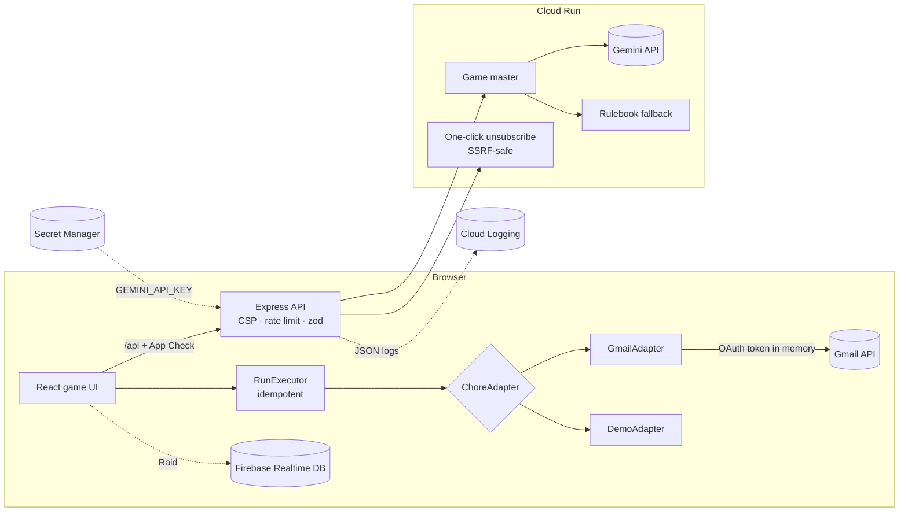

# 👻 Inboxorcist

**A fast-paced Halloween arcade game that actually cleans your Gmail inbox while you play.**

Built for _PromptWars × OUTLIER'2026_. The challenge: _"Build an experience where playing a fast-paced game or interactive story actually executes the real-world chore in the background."_

Your inbox is haunted: every unread email is a ghost. Gemini, acting as the game master, reads a sample of your inbox and turns your noisiest senders into bosses with names and taunts based on your real mail ("The Swiggy Specter — 430 HP: _I sent you 430 emails about biryani…_"). **Every hit you land is a real Gmail API call** that marks a chunk of that sender's mail as read and archives it. The HP bar drops only after Gmail confirms the change.

> **Why a game?** Nobody trusts an AI with "archive all", and nobody wants to review 5,000 emails by hand. The game sits in between: **Gemini proposes, the player approves, at a couple of decisions per second.** Grouping by sender means 5,000 emails take a few dozen decisions instead of 5,000 swipes.

## How a run works

1. **Scan.** The game reads the exact unread count and the metadata (sender, subject, snippet) of the 300 most recent unread emails, then groups them by sender.
2. **Game master.** Gemini returns a verdict per sender as structured JSON: banish, keep or rescue, plus a confidence score, an importance flag, a boss name, a taunt and a privacy-safe summary. A rule-based fallback fills any gaps, and safety always wins: an important sender is never bulk-archived, whatever the model says.
3. **Boss fights.** Each confidently banishable sender is a boss whose HP equals its real unread count. Hit the moving weak spot (click, tap, or press the arrow key it shows). Each hit runs one `users.messages.batchModify` call that removes `UNREAD` and `INBOX` and adds the run label.
4. **Seal forever.** After a boss dies you can create a Gmail filter so future mail from that sender skips the inbox, plus an RFC 8058 one-click unsubscribe where the sender supports it.
5. **Ghost waves.** Mail Gemini is unsure about flies in one email at a time: ← banish, → keep, ↑ rescue (or swipe). The waves speed up. If time runs out, the email is **kept**, which is the safe default.
6. **Trapped souls.** Important mail (real people, bills, deadlines) can only be rescued: starred, labelled `Inboxorcist/Needs-Reply`, and optionally given a Gemini-drafted reply saved as a Gmail draft.
7. **End screen.** Shows the unread count before and after, time, score and Gemini's roast, plus **Resurrect**, which undoes the whole run in one click.

### Raid Night (multiplayer)

The host puts the game on a big screen. Players scan a QR code and join from their phones with only a nickname, no login. Everyone taps to damage the boss: every 50 combined taps is one real archive call on the host's inbox. Players also vote banish or keep on uncertain mail, and the majority wins (a tie keeps the email). The Gmail token never leaves the host's browser, and players never see sender names or subjects, only Gemini's privacy-safe summaries. If the host drops offline, the raid pauses and resumes on reconnect.

## Safety model

| Guarantee                       | How                                                                                                                                              |
| ------------------------------- | ------------------------------------------------------------------------------------------------------------------------------------------------ |
| Nothing is ever deleted         | Only label changes (`batchModify`); no `trash` or `delete` calls exist in the codebase                                                           |
| Every action is undoable        | Banished mail carries the `Inboxorcist/<runId>` label; **Resurrect** restores it and deletes filters the run created                             |
| Important mail is protected     | Gemini flags plus rule-based protection (money, deadlines, personal domains); important ids are excluded from boss chunks and cannot be banished |
| No double actions               | `RunExecutor` tracks processed and in-flight ids, so retries and double taps never apply twice                                                   |
| The safe default when uncertain | Ghost timeouts and tied votes keep the email                                                                                                     |

## Google services

| Service                                       | Used for                                                                                       |
| --------------------------------------------- | ---------------------------------------------------------------------------------------------- |
| **Gemini API** (`@google/genai`)              | Game master: sender verdicts (JSON schema output), boss names and taunts, roasts, reply drafts |
| **Gmail API**                                 | Unread counts, metadata, `batchModify`, labels, filters, drafts                                |
| **Google Identity Services**                  | OAuth 2.0 token client with incremental authorization                                          |
| **Cloud Run**                                 | Hosts the app (one container: Express API + static client)                                     |
| **Secret Manager**                            | Stores `GEMINI_API_KEY` for Cloud Run                                                          |
| **Cloud Logging**                             | Structured JSON logs (`severity`, no personal data)                                            |
| **Firebase Realtime Database**                | Raid rooms, presence, taps and votes, protected by `database.rules.json`                       |
| **Firebase Authentication** (anonymous)       | Identity for raid players without asking them to log in                                        |
| **Firebase App Check** (reCAPTCHA Enterprise) | Protects `/api` and the database from abuse                                                    |

## OAuth scopes

| Scope                  | When it is requested                               | Why                                                |
| ---------------------- | -------------------------------------------------- | -------------------------------------------------- |
| `gmail.modify`         | On "Connect Gmail"                                 | Read metadata, mark read and archive, labels, undo |
| `gmail.settings.basic` | Only when the player first clicks **Seal forever** | Create (and on undo, delete) the skip-inbox filter |
| `gmail.compose`        | Only when the player enables **Draft replies**     | Save reply drafts for rescued emails (never sends) |

The access token lives in browser memory only. It is never stored and never sent to our server.

## Privacy

- **Sent to Gemini (through our server):** sender address and display name, plus subject and snippet of up to 5 sample emails per sender, wrapped in `<data>` tags and treated as untrusted input. For reply drafts: the rescued email's sender name, subject and snippet.
- **Never leaves the browser:** the OAuth token, message bodies and attachments.
- **Raid players see only:** Gemini's summary (for example "Food delivery promotions"), HP and vote counts. The database rules reject any other fields.
- **Logs:** request method, path, status and latency. Log fields that could hold personal data are redacted automatically.

## Security

- Strict **Content Security Policy** with a per-request nonce and `'strict-dynamic'`, no `unsafe-inline` or `unsafe-eval` anywhere (`style-src-attr 'none'`), `object-src 'none'` and `frame-ancestors 'none'`. Also HSTS, `X-Frame-Options: DENY`, a restrictive `Permissions-Policy` (camera, microphone, geolocation, payment and so on all off) and COOP `same-origin-allow-popups` (needed for the Google sign-in popup).
- **Untrusted data is validated everywhere:** API bodies, Gemini output and Firebase room snapshots all go through zod schemas before use.
- Dependabot keeps npm and Actions dependencies patched. See [SECURITY.md](SECURITY.md) for the reporting policy.
- **CSRF / CORS:** state-changing API calls from other origins get a 403, and no CORS headers are ever sent.
- **Input validation** with zod on every endpoint, a 64 kB body limit, and **rate limiting** (60/min for the API, 20/min for unsubscribe).
- **SSRF protection** for one-click unsubscribe: HTTPS only, default port, no credentials, and every DNS answer checked against private and reserved ranges _at connect time_ (no DNS-rebinding gap). Redirects are not followed and the timeout is 5 s.
- **Prompt-injection hardening:** email content is fenced as data, and model output is schema-validated, length-clamped and merged with the rulebook so it cannot widen what gets archived.
- **Firebase App Check** on `/api` (`ENFORCE_APP_CHECK=true`) and on the Realtime Database.
- Gmail query building rejects anything that is not a plain email address.
- `npm audit --omit=dev` is clean, and CI enforces it.

## Accessibility

- The whole game can be played with the keyboard: arrow keys for every action, visible focus rings, a skip link, and focus moved to each new screen's heading.
- Every game action is announced through ARIA live regions (polite and assertive).
- `prefers-reduced-motion`: the weak spot stays still, timers are generous, and shake and float animations are disabled.
- Hints use icon plus text, never colour alone. The HP bar is a labelled `progressbar` with `aria-valuetext`.
- **Streamer mode** blurs senders and subjects for projectors.
- Automated **axe WCAG 2.2 AA** checks run on every screen in Playwright.

## Architecture



`ChoreAdapter` (`scan`, `apply`, `undo`, `seal`, `createDraft`) is the plug-in point: a Drive, Downloads-folder or expenses adapter would plug into the same game.

```
server/            Express app (app.ts), /api router (routes/), security, logging and error middleware,
                   Gemini game master, SSRF-safe unsubscribe, static client with CSP nonces
shared/            Types, zod schemas, constants, rule-based classifier (used by client and server)
src/adapters/      ChoreAdapter, GmailAdapter, Gmail REST client, Google auth, DemoAdapter
src/features/      solo · boss · ghosts · endscreen · raid · home (one component per file, logic in hooks)
src/lib/           Executor, encounter builder, scoring, MIME, retry/concurrency, API client
tests/             unit (jsdom) · server (node) · rules (Firebase emulator)
e2e/               Playwright: demo, keyboard-only, axe accessibility, raid (two browsers)
```

## Run locally

```bash
npm ci
cp .env.example .env        # optional: add GEMINI_API_KEY / GOOGLE_CLIENT_ID / Firebase config
npm run dev                 # API on :8080, Vite on :5173 (.env is loaded automatically)
```

Demo Mode works with **no configuration at all**. Without a Gemini key the game uses the offline rulebook.

## Testing

| Command                       | What it runs                                                                                   |
| ----------------------------- | ---------------------------------------------------------------------------------------------- |
| `npm test`                    | 230+ Vitest unit, component and API tests                                                      |
| `npm run coverage`            | The same suite with coverage, enforcing ≥90% lines, functions and statements and ≥85% branches |
| `npm run test:rules`          | Realtime Database security rules on the Firebase emulator                                      |
| `npm run e2e`                 | Playwright: full demo run, keyboard-only run, axe on every screen, mobile                      |
| `RAID_E2E=1 npm run e2e:raid` | Raid Mode with a host and a player browser on the Firebase emulators                           |
| `npm run lint`                | ESLint (strict type-checked + jsx-a11y strict + react-hooks)                                   |
| `npm run typecheck`           | TypeScript strict across client, server and tooling                                            |

CI (`.github/workflows/ci.yml`) runs every check on every push: lint, typecheck, format check, unit tests with coverage, build, npm audit, rules tests and all Playwright suites.

## Deploy to Vercel (live demo)

The live demo runs on Vercel: `api/server.js` runs the whole Express app as one function, Vercel's CDN serves the hashed assets, and `vercel.json` rewrites everything else to the function, so the per-request CSP nonce still works.

```bash
npx vercel link --project inboxorcist
# add GEMINI_API_KEY (as --sensitive), GEMINI_MODEL, GOOGLE_CLIENT_ID and FIREBASE_* with `npx vercel env add <NAME> production`
npx vercel deploy --prod
```

Add the Vercel URL to the OAuth client's _Authorized JavaScript origins_.

## Deploy to Cloud Run

```bash
gcloud services enable run.googleapis.com cloudbuild.googleapis.com secretmanager.googleapis.com gmail.googleapis.com
printf '%s' "$GEMINI_API_KEY" | gcloud secrets create gemini-api-key --data-file=-

gcloud run deploy inboxorcist \
  --source . \
  --region asia-south1 \
  --allow-unauthenticated \
  --set-secrets GEMINI_API_KEY=gemini-api-key:latest \
  --set-env-vars GOOGLE_CLIENT_ID=<client-id>,FIREBASE_API_KEY=<...>,FIREBASE_AUTH_DOMAIN=<...>,FIREBASE_DATABASE_URL=<...>,FIREBASE_PROJECT_ID=<...>,FIREBASE_APP_ID=<...>
```

Then:

1. **OAuth client:** add the Cloud Run URL to the _Authorized JavaScript origins_. While the consent screen is in _Testing_, add the Gmail accounts that will play as _test users_.
2. **Firebase:** deploy the rules with `npx firebase-tools deploy --only database`.
3. **App Check (optional):** create a reCAPTCHA Enterprise key, then set `RECAPTCHA_SITE_KEY` and `ENFORCE_APP_CHECK=true`.
4. Grant the Cloud Run service account the `Secret Manager Secret Accessor` role if the deploy asks for it.

Anyone can open the deployed link and play Demo Mode without signing in.
